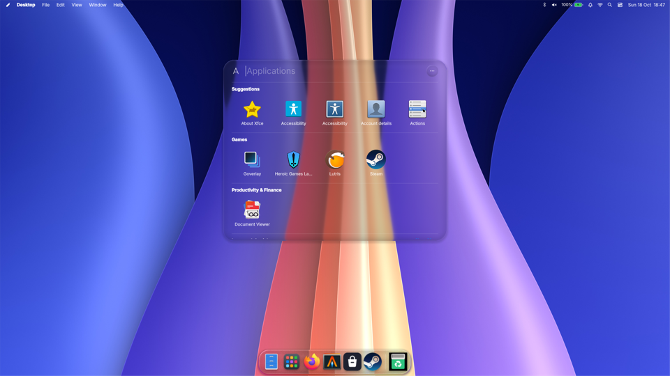

# gluemac

[](https://github.com/vladbiber/gluemac/actions/workflows/build.yml)
[](LICENSE)
[](https://gitlab.freedesktop.org/wlroots/wlroots/-/releases/0.20.2)

gluemac is a Wayland compositor that behaves like macOS: free-floating windows
with traffic-light title bars, Spaces, Mission Control, full screen apps in
their own Space and the gestures that go with them. It is the compositor behind
the Glue Mac session of [Glue Linux](https://github.com/vladbiber/glue-linux),
where [MacShell](https://github.com/0-ss/MacShell) draws the menu bar and the
Dock.

It is a fork of [gluewc](https://github.com/vladbiber/gluewc), itself a fork of
[dwl 0.8](https://codeberg.org/dwl/dwl), built on
[wlroots 0.20](https://gitlab.freedesktop.org/wlroots/wlroots) and a patched
copy of [SceneFX 0.5](https://github.com/wlrfx/scenefx) (in `scenefx/`) that
adds the Liquid Glass rim.



*Glue Mac: MacShell's menu bar, Applications and Dock on gluemac.*

## Highlights

- Stacking windows with a title bar drawn by the compositor: traffic lights,
  title, double-click to zoom, resizing from every edge, a soft drop shadow
- Spaces per monitor, with Mission Control showing them as live thumbnails;
  three-finger swipes follow the fingers between Spaces, pinch for Launchpad
- Full screen apps get a Space of their own; at the top edge the menu bar and
  the title bar come down over them on a black strip
- Genie minimise, Cmd+Tab, Cmd+Opt+Esc for Force Quit
- Frosted shell panels with a Liquid Glass rim, matched by layer-shell
  namespace; their soft shadows are left clear (`blur_ignore_alpha`)
- Hyprland's IPC and the toplevel export/mapping protocols, so MacShell and
  other Hyprland shells run on it unchanged
- Everything from gluewc underneath: BSP, scrolling and drift layouts, the
  overview, runtime config reloaded on save, live monitor setup, XWayland,
  layer-shell, session lock, dwl IPC and foreign-toplevel

## Install

One script covers all four cases. It detects the distribution, installs the
build dependencies and audio, builds a compatible wlroots/SceneFX pair when
the distribution does not package one, and installs the session entry. It asks
for administrator privileges for the packages and the system install, and it
never writes to `~/.config/gluemac/config.conf`.

**Just the compositor:**

```sh
curl -fsSL https://raw.githubusercontent.com/vladbiber/gluemac/main/install.sh | sh
```

**With the bar** — [glueqs](https://github.com/vladbiber/glueqs), a quickshell
bar built for gluemac. Installs Quickshell from the distribution, or builds it
where there is no package (Chimera, Alpine, openSUSE), adds the tools its
panels use, clones the bar into `~/.config/quickshell/glueqs` and starts it
from the session:

```sh
curl -fsSL https://raw.githubusercontent.com/vladbiber/gluemac/main/install.sh | sh -s -- --with-bar
```

**Update an existing checkout** — pulls the newest source, rebuilds, installs,
and finishes by listing what the defaults gained that your own config does not
have. Your config is left alone; you copy across whatever you want:

```sh
cd gluemac && ./install.sh --update          # add --with-bar to update that too
./install.sh --check-config                 # only the list, no rebuild
```

**By hand**, to read the script first or to build without it:

```sh
git clone https://github.com/vladbiber/gluemac.git
cd gluemac
less install.sh
./install.sh          # or: make && sudo make install
```

The dependency resolver covers current releases of:

| Family | Target |
| --- | --- |
| Arch | Arch Linux, EndeavourOS, Manjaro, CachyOS, Garuda, Artix, ArcoLinux |
| Debian | Debian 13+, Devuan |
| Ubuntu | Ubuntu 25.10+, Mint, Pop!\_OS, elementary, Zorin, Kali, Raspberry Pi OS |
| Fedora | Fedora 43+, Nobara, RHEL, CentOS Stream, Rocky, AlmaLinux |
| SUSE | openSUSE Tumbleweed and Leap |
| Gentoo | Gentoo Linux |
| Alpine | Alpine Edge, postmarketOS |
| Chimera | Chimera Linux (clang, musl, dinit; `doas` is used when there is no `sudo`) |
| Void | Void Linux rolling |
| NixOS | through the flake in this repository, finix included |

A distribution outside the list still works: the installer falls back to
whichever package manager it finds on `PATH` and uses that family's package
set. Gentoo is hardware-tested and the Arch path is exercised by CI. The
remaining resolvers target their current package sets. Older distributions may
not have the Wayland, libdrm and Pixman versions required by wlroots 0.20; see
[the installation guide](docs/INSTALL.md) for manual and troubleshooting
instructions.

Sound is set up along the way: PipeWire, WirePlumber and the ALSA and
PulseAudio bridges are installed and, where there are systemd user units,
enabled. Pass `--no-audio` to keep your own audio stack.

### NixOS

```sh
nix run github:vladbiber/gluemac          # try it without installing
```

Permanently, add the flake as an input and enable the module, which registers
the session and sets up PipeWire, the portals and Xwayland:

```nix
imports = [ inputs.gluemac.nixosModules.default ];
programs.gluemac.enable = true;
programs.gluemac.bar.enable = true;   # the glueqs bar, with Quickshell from nixpkgs
```

### From source

```sh
git clone https://github.com/vladbiber/gluemac.git
cd gluemac
./install.sh --deps-only     # or install the dependencies yourself
make
sudo make install
```

[The installation guide](docs/INSTALL.md) covers `PREFIX`, `DESTDIR`,
`config.h`, building against a private wlroots and staying up to date.

After installation, log out and select **gluemac** in the display manager. From
a TTY, run:

```sh
gluemac-session
```

The default bindings expect `alacritty`, `rofi`, `grim` and `slurp` for
screenshots, `wl-clipboard` to put one on the clipboard, `playerctl` for the
media keys, and for volume and backlight either `wpctl`/`pactl` and
`brightnessctl`/`light`. The installer brings them in; they stay optional and
every command can be replaced in the runtime config.

## First steps

The session wrapper creates `~/.config/gluemac/config.conf` on first login.
Saving it applies it: the file is watched and reloaded on the spot, and
anything the parser rejects raises a red strip across the top of the screen
and a notification naming the line. `Super+Shift+R` still reloads by hand.

| Binding | Action |
| --- | --- |
| `Super` tap | Toggle overview |
| `Super+Return` or `Super+Q` | Open terminal |
| `Super+Space` | Open Rofi |
| `Super+1` … `Super+9` | Change workspace |
| `Super+Ctrl+1` … `Super+Ctrl+9` | Move window and follow |
| `Super+Arrow` or `Super+H/J/K/L` | Directional focus |
| `Super+Shift+Arrow` | Swap windows (nudge them in the drift layout) |
| `Super+N` | Cycle BSP, scroll and drift layouts |
| `Super+Ctrl+Arrow` | Move the window that way: swap with the neighbour, or on to the next workspace when there is none |
| `Super+Alt+Arrow` | Pan the drift canvas |
| `Print` / `Shift+Print` | Screenshot the screen / a selected area |
| `Ctrl+Print` / `Super+Shift+S` | The same, onto the clipboard |
| `Super+drag` | Swap the window with the tile it is dropped on |
| `Super+right-drag` | Resize the window against its neighbours |
| `Super+Shift+drag` | Drag the drift canvas around with the mouse |
| `Super+W`, `Super+±`, `Super+0` | Drift: fit, zoom, 1:1 |
| `Super+wheel` / `Super+Ctrl+wheel` | Change workspace / take the window along |
| `Super+Shift+wheel` | Zoom the drift camera |
| `Super+F` | Workspace-area fullscreen |
| `Super+Shift+F` | Real fullscreen |
| `Super+V` | Toggle centered floating |
| `Super+C` | Close window |
| `Super+O` | Toggle configured transparency |
| `Super+Escape` | Enter normal mode; `I` returns to insert mode |
| `Super+Shift+R` | Reload config in place (it also reloads itself when saved) |
| `Super+M` or `Super+Shift+Q` | Quit gluemac |

Media, volume and backlight sit on the function row, so they work on keyboards
without media keys or with them behind `Fn`. The media keys themselves keep
doing the same thing, and in normal mode the same keys need no `Super`.

| Binding | Action |
| --- | --- |
| `Super+F1` | Play / pause |
| `Super+F2` / `Super+F3` | Previous / next track |
| `Super+Shift+F2` / `Super+Shift+F3` | Seek 10s back / forward |
| `Super+F4` / `Super+Shift+F4` | Mute output / microphone |
| `Super+F5` / `Super+F6` | Volume down / up |
| `Super+F7` / `Super+F8` | Backlight down / up |

Playback needs `playerctl`. Volume goes through `wpctl` (part of WirePlumber,
so it is there on any PipeWire system) and falls back to `pactl`; the backlight
goes through `gluemac-backlight`, which drives `brightnessctl` (or `light`) in
5% steps down to 10% and 1% steps below that, so it reaches 0 and turns the
panel off. Every one of these is a plain `spawn:` line in the config, so they
can be pointed at anything else.

In the overview, use arrows, workspace numbers, the mouse wheel or a two-finger
horizontal swipe to navigate. Click a window to focus it, or drag it onto the
left, center or right workspace. Every `Super` binding still works while it is
up — open a terminal, close a window, switch layouts — and the cards follow;
`Super+1…9` and the workspace bindings move the overview instead of switching
underneath it. `start_in_overview = true` opens the session on it.
A three-finger horizontal swipe changes the
workspace from the desktop; a three-finger vertical swipe opens or closes the
overview. `Super+wheel` also changes workspace. In the drift layout three
fingers pan the canvas and a pinch zooms it, so four fingers take over
workspaces and the overview there.

## Desktop components

gluemac deliberately does not bundle a bar, launcher or wallpaper daemon.
Layer-shell clients reserve their own space, and wallpaper layers are included
in the overview.

Examples for `~/.config/gluemac/config.conf`:

```ini
autostart = swaybg -i ~/Pictures/wallpaper.jpg -m fill
autostart = waybar
```

With no wallpaper program, `root_color = 000000` keeps the background black.
Waybar can use its `dwl` workspaces module; desktop shells can also consume the
foreign-toplevel protocol. For shells without a dwl-ipc module gluemac keeps
`$XDG_STATE_HOME/gluemac/workspaces` up to date (one line per output: name,
active, workspace, window counts, layout) and installs `gluemac-msg`, which
speaks the same protocol from the command line:

```sh
gluemac-msg status                        # one line per output
gluemac-msg outputs                       # geometry, modes, mirror of each monitor
gluemac-msg -o eDP-1 workspace 3          # view workspace 3 there
gluemac-msg move 2                        # send the focused window to 2
gluemac-msg layout scroll
gluemac-msg -o eDP-1 power off            # switch the panel off (on brings it back)
```

### glueqs

[glueqs](https://github.com/vladbiber/glueqs) is a Quickshell desktop shell
written alongside gluemac: a dot-matrix bar with workspaces, tray, media,
network, weather and notifications, plus OSDs, a launcher, the wallpaper (it
paints it itself, with a picker on `Super+W`) and a dash that appears over the
overview. It is the shell in the video above. It runs on upstream Quickshell,
so it works with whatever `quickshell` your distribution packages.

It is entirely optional — gluemac runs with waybar, any other layer-shell bar,
or none at all — but it is the combination the compositor is developed against:

```ini
autostart = qs -c glueqs
```

### MacShell and other Hyprland shells

gluemac answers Hyprland's IPC: the request and event sockets under
`$XDG_RUNTIME_DIR/hypr/gluemac-<display>/`, the `hl.dsp.*` dispatchers, and the
toplevel export and mapping protocols that window previews use. The signature
is not exported to the session, so programs only take gluemac for Hyprland when
they are pointed at it; `gluemac-hyprctl` (also installed as `hyprctl` in
`/usr/lib/gluemac/bin`) is a client for it.

[MacShell](https://github.com/0-ss/MacShell), the macOS Tahoe style menu bar,
Dock and lock screen by Rickky and vSuol, runs on it this way. Glue Linux
packages it with a launcher that sets this up:

```ini
autostart = glue-macshell
```

## Configuration and building

- [Installation and distro notes](docs/INSTALL.md)
- [Configuration, actions and gestures](docs/CONFIGURATION.md)
- [Default runtime config](config.def.conf)
- [Contributing](CONTRIBUTING.md)

Manual build, once dependencies are installed:

```sh
make
sudo make install
```

Compiled defaults remain in `config.def.h`; normal users only need the runtime
config. Run `man gluemac` for command-line and environment details.

## License and credits

gluemac is GPL-3.0-or-later. It stands on:

- [gluewc](https://github.com/vladbiber/gluewc), the compositor it was forked from
- [dwl](https://codeberg.org/dwl/dwl), which grew from the wlroots TinyWL
  example and carries code influenced by [dwm](https://dwm.suckless.org) and
  [sway](https://swaywm.org)
- [wlroots](https://gitlab.freedesktop.org/wlroots/wlroots) and
  [SceneFX](https://github.com/wlrfx/scenefx) (MIT), vendored and patched in `scenefx/`
- [niri](https://github.com/YaLTeR/niri) and
  [driftwm](https://github.com/malbiruk/driftwm), whose layouts the scrolling and
  drift modes follow
- [Hyprland](https://hyprland.org), whose IPC it speaks
- [MacShell](https://github.com/0-ss/MacShell) by Rickky and vSuol (MIT), the
  shell it is developed with

See `LICENSE*` and the Git history for the complete notices.
